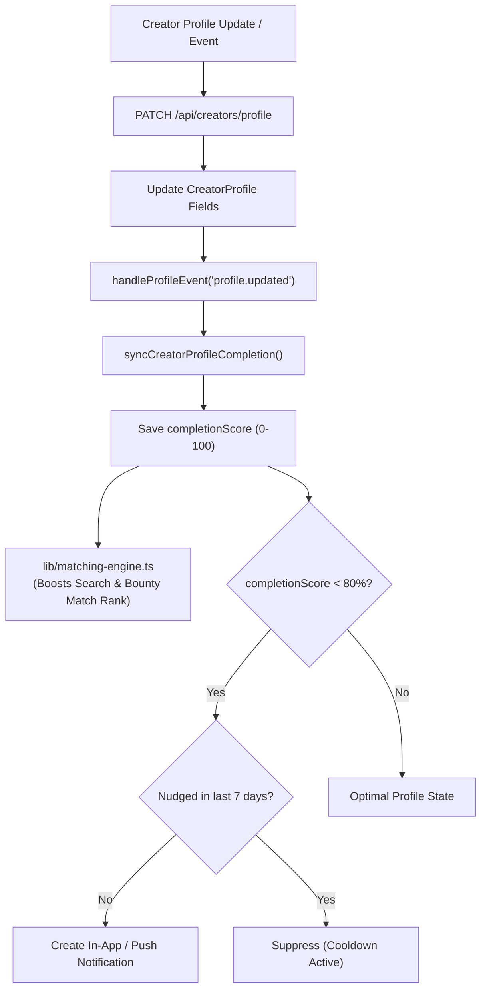

# Profile Completion Scoring & Event-Driven Nudges (Issue #1825)

This document describes the server-side architecture for calculating, persisting, and leveraging creator profile completion scores, along with event-driven recalculations, match ranking integration, and automated nudges.

---

## 1. Architectural Overview

Previously, profile completion was calculated purely on the client side (`components/profile/profile-completion-indicator.tsx`), meaning completion data was unavailable for server-side matchmaking, search ranking, or proactive creator retention notifications.

Issue #1825 introduces:
1. **Database Persistence**: Added `completionScore` (0–100 integer) and database index `@@index([completionScore])` to the `CreatorProfile` model.
2. **Server-Side Event Handler**: `server/services/profile-events.ts` listens to profile lifecycle events (`profile.updated`, `skills.updated`, `portfolio.updated`, etc.) and automatically synchronizes the database score.
3. **Match Ranking Integration**: `lib/matching-engine.ts` directly factors `completionScore` into creator reputation metrics and ranking. Creators with higher profile completion scores rank higher in bounty recommendations and client searches.
4. **Targeted Nudge Notifications**: Creators with profile completion below 80% receive non-intrusive notifications highlighting the specific high-impact missing elements, with an enforced 7-day cooldown.

---

## 2. Profile Completion Weights

Scoring is computed deterministically in `lib/profile-completion.ts`:

| Field | Weight | Requirement |
| :--- | :---: | :--- |
| **Portfolio Sample** | 25% | At least 1 portfolio link or project showcase |
| **Bio** | 20% | Non-empty biography describing creator skills |
| **3+ Skills** | 15% | Minimum of 3 declared skills |
| **Profile Photo (Avatar)** | 15% | Valid avatar URL |
| **Display Name** | 10% | Minimum 2 characters |
| **Social Links** | 10% | Verified GitHub or LinkedIn link |
| **Identity Verification** | 5% | Stellar on-chain or KYC verification |
| **Total** | **100%** | |

---

## 3. Event-Driven Workflow



---

## 4. Matching Engine Integration

In `lib/matching-engine.ts`:
- **Reputation Formulation**:
  ```typescript
  if (creator.completionScore != null) {
    const comp = clamp01(creator.completionScore / 100);
    return rating * 0.50 + completedProjects * 0.30 + comp * 0.20;
  }
  ```
- **Component Breakdown**: `breakdown.components.profileCompletion` surfaces the normalized score (0–1).
- **Match Reasons**: Adds `High profile completeness score` or `Incomplete profile details may affect match ranking` to the explanation card.

---

## 5. Nudge Notification Hygiene

- **Trigger Threshold**: `PROFILE_NUDGE_THRESHOLD = 80`.
- **Cooldown**: `PROFILE_NUDGE_COOLDOWN_DAYS = 7`.
- **Personalized Recommendations**: Extracts the top 2 highest-weight missing fields (e.g. portfolio sample + bio) and generates targeted guidance.
- **Batch Evaluation**: `batchEvaluateProfileNudges()` provides a background sweep utility for automated scheduled nudges.
