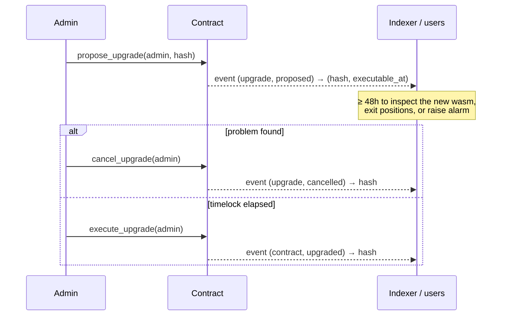

# Soroban contract deploy & upgrade process

How CI deploys the Soroban smart contracts in `backend/contracts/*`, where
the resulting contract addresses go, and how to upgrade a contract that is
already live without breaking its callers.

## Networks

| Network | Workflow | Trigger | Approval |
|---|---|---|---|
| Testnet | [`deploy-contracts.yml`](../.github/workflows/deploy-contracts.yml) | Every push to `main` | None — automatic |
| Mainnet | [`deploy-mainnet.yml`](../.github/workflows/deploy-mainnet.yml) | A GitHub **release** being published (not drafts, not pre-releases) | Manual: the `mainnet` GitHub Environment requires reviewer approval before the job runs |

Merging to `main` only ever reaches Testnet. Mainnet always requires a
deliberate release (see "Promoting to Mainnet" below) — this is enforced by
the workflow trigger itself (`on: release: types: [published]`), not just by
convention.

```mermaid
flowchart LR
    PR[PR merged to main] --> TN[deploy-contracts.yml\nTestnet, automatic]
    TN --> QA[Manual QA on Testnet]
    QA --> REL[Tag + publish a GitHub release\nvX.Y.Z]
    REL --> VAL[validate-release\nsemver tag, not a pre-release]
    VAL --> SIM[simulate-contracts\nsimulate against 2 RPC endpoints]
    SIM --> APPROVAL{{mainnet environment\nreviewer approval}}
    APPROVAL --> DEPLOY[deploy-contracts job\nnode scripts/deploy.cjs]
    DEPLOY --> FE[deploy-frontend\nVercel production, contract IDs baked in]
```

## What each pipeline does

### Testnet (`deploy-contracts.yml`)

1. `test` — `cargo test --workspace --all-features` against the `backend`
   workspace.
2. `build` — installs `stellar-cli`, builds the bounty / escrow /
   freelancer / governance / oracle / identity contract packages for
   `wasm32v1-none` (soroban-sdk 23 refuses `wasm32-unknown-unknown` on
   Rust ≥ 1.82), then runs
   `stellar contract optimize` on each `.wasm` and uploads them as a build
   artifact (`contract-wasm-${{ github.sha }}`).
3. `deploy-testnet` — downloads that artifact and runs
   [`scripts/deploy.cjs`](../scripts/deploy.cjs) against
   `https://soroban-testnet.stellar.org` using the `TESTNET_DEPLOYER_SECRET`
   repository secret (or a throwaway Friendbot identity when unset). It
   writes `contracts.json` and
   [`deployments/testnet.json`](../deployments/testnet.json), uploads both as
   the `contracts-testnet-${{ github.sha }}` artifact, and commits the
   manifest back to the branch (see [`docs/deployments.md`](./deployments.md)).
4. `notify` — posts success/failure to Slack (if `SLACK_WEBHOOK_URL` is
   set) and writes a `$GITHUB_STEP_SUMMARY`.

### Mainnet (`deploy-mainnet.yml`)

1. `validate-release` — rejects the run unless `GITHUB_REF_NAME` is a plain
   semver tag (`vX.Y.Z`) with no pre-release suffix (`v1.0.0-rc.1` is
   rejected). This is the only gate that stands between a release and a
   mainnet deploy, so it fails closed.
2. `simulate-contracts` — rebuilds the same packages, reruns the unit
   tests, then runs `node scripts/deploy.cjs --simulate-only` against the
   primary Mainnet RPC (blocking) and again against a secondary RPC
   provider for cross-validation (warning-only, so a degraded secondary
   doesn't block a release).
3. `deploy-contracts` — gated on the `mainnet` GitHub Environment (configure
   required reviewers there — this is what makes the deploy "manual
   approval" in practice). Runs `node scripts/deploy.cjs --manifest deployments/mainnet.json` for
   real against Mainnet with `MAINNET_DEPLOYER_SECRET`, exposes each contract
   ID as a job output, and attaches `deployments/mainnet.json` to the release.
4. `deploy-frontend` — builds the Next.js app with
   `NEXT_PUBLIC_{BOUNTY,ESCROW,FREELANCER,GOVERNANCE,ORACLE,IDENTITY}_CONTRACT_ID`
   set from the previous job's outputs, then deploys to Vercel production.
5. `notify` — Slack + Discord with every contract ID, plus a step summary.

## Where contract addresses go

Addresses are published to committed manifests under
[`deployments/`](../deployments). See [`docs/deployments.md`](./deployments.md)
for the schema; the app reads them via `lib/contracts/deployments.ts`.

- **Testnet**: [`deployments/testnet.json`](../deployments/testnet.json),
  committed by `deploy-contracts.yml` after every deploy (also uploaded in the
  `contracts-testnet-${{ github.sha }}` artifact alongside `contracts.json`).
- **Mainnet**: emitted as `deploy-contracts` job outputs
  (`bounty_contract_id`, `escrow_contract_id`, `freelancer_contract_id`,
  `governance_contract_id`, `oracle_contract_id`, `identity_contract_id`),
  which `deploy-frontend` reads directly and bakes into the Next.js build as
  `NEXT_PUBLIC_*_CONTRACT_ID`. They are also broadcast to Slack/Discord and
  the GitHub Actions run summary for a human-readable record of what's live,
  and `deployments/mainnet.json` is attached to the GitHub release.
- **Local dev**: `.env.local` (see `.env.example`) — there is no automated
  sync from a deploy back into `.env.example`; update it by hand after a
  Mainnet/Testnet address changes if local tooling needs to point at it.

## Promoting to Mainnet

1. Confirm the commit has been live on Testnet and manually exercised.
2. Tag it and publish a GitHub release with a plain semver tag, e.g. `v1.4.0`
   — publishing a **draft** or a **pre-release** tag will not trigger
   `deploy-mainnet.yml` at all (draft) or will be rejected by
   `validate-release` (pre-release suffix).
3. The `mainnet` GitHub Environment will block `deploy-contracts` until a
   configured reviewer approves the run — approve it from the Actions tab
   once you've checked `simulate-contracts` passed cleanly.
4. After `deploy-frontend` finishes, confirm the new contract IDs in the
   Slack/Discord notification (or the run's `$GITHUB_STEP_SUMMARY`) match
   what you expect before telling anyone the release is out.

## Upgrading a contract that is already live

Upgrades are **timelocked**, and the admin role moves in **two steps**
(Issue #1564). The shared logic lives in
[`backend/contracts/upgradeable`](../backend/contracts/upgradeable/src/lib.rs)
(crate `stellar-upgradeable`). Every contract with an admin calls into it:
bounty, escrow, freelancer, governance, oracle, identity, stellar_insights,
core, referral and insurance.

### Why

Before this change, each contract had an `upgrade(admin, new_wasm_hash)`
entrypoint that swapped the code **in the same transaction**. Anyone holding
the admin key, including an attacker who had stolen it, could replace a
contract's logic (for example to drain escrowed funds) with no warning to
users. The admin role also couldn't be rotated safely. It was either fixed
forever or set once through `set_admin`, with nothing to stop a typo from
handing it to an address no one controls.

### Entrypoints (same on every contract)

| Entrypoint | Who signs | Effect |
|---|---|---|
| `propose_upgrade(admin, new_wasm_hash) -> u64` | admin | Records the pending upgrade and returns `executable_at` (now + 48h). A new proposal replaces the old one and restarts the clock. |
| `execute_upgrade(admin)` | admin | Swaps in the pending wasm if `now >= executable_at`. |
| `cancel_upgrade(admin)` | admin | Drops the pending upgrade. |
| `get_pending_upgrade() -> Option<PendingUpgrade>` | — | `{ wasm_hash, proposed_at, executable_at }` |
| `propose_admin(admin, new_admin)` | admin | Nominates a successor. Nothing changes yet. |
| `accept_admin(new_admin)` | **nominee** | Completes the transfer, so the nominee must prove they control the key. |
| `cancel_admin_transfer(admin)` | admin | Drops the nomination. |
| `get_pending_admin() -> Option<Address>` | — | The current nominee, if any. |

The instant `upgrade` entrypoint has been **removed**. The timelock is the
constant `UPGRADE_TIMELOCK_SECS` (48 hours) on every network.

### Events

| Topics | Data |
|---|---|
| `(upgrade, proposed)` | `(wasm_hash: BytesN<32>, executable_at: u64)` |
| `(upgrade, cancelled)` | `wasm_hash` |
| `(contract, upgraded)` | `wasm_hash`. Same shape as the old instant upgrade, so existing indexer mappings still work. |
| `(admin, proposed)` | `(current_admin, nominee)` |
| `(admin, accepted)` | `(previous_admin, new_admin)` |
| `(admin, cancelled)` | `nominee` |

Indexers and monitoring should alert on `(upgrade, proposed)`. That event is
users' advance notice of a code change. Read events with Soroban RPC
[`getEvents`](https://developers.stellar.org/docs/data/apis/rpc/api-reference/methods/getEvents).

### Errors

These surface as `Error(Contract, #n)`. The codes start at 900 so they never
overlap a contract's own error enum.

| Code | Variant | Meaning |
|---|---|---|
| 900 | `Unauthorized` | Caller is not the stored admin |
| 901 | `NoPendingUpgrade` | `execute_upgrade` or `cancel_upgrade` was called with nothing pending |
| 902 | `TimelockNotElapsed` | `execute_upgrade` was called before `executable_at` |
| 903 | `NoPendingAdmin` | `accept_admin` or `cancel_admin_transfer` was called with no nominee |
| 904 | `NotPendingAdmin` | `accept_admin` was signed by someone other than the nominee |
| 905 | `SameAdmin` | `propose_admin` nominated the current admin |

### Procedure

1. Build and optimize the new `.wasm` the same way CI does (`cargo build
   --release --target wasm32v1-none`, then `stellar contract
   optimize`) so the deployed bytecode matches what was reviewed.
2. Upload it to get its hash:
   `stellar contract upload --wasm <path> --source <admin-identity> --network <network>`.
3. Simulate the `upgrade` call first (`stellar contract invoke --is-view`
   where supported, or a Testnet dry run) to confirm the new wasm hash and
   admin signature are both accepted before touching Mainnet.
4. Call `upgrade(admin, new_wasm_hash)` from the platform admin key. Because
   this requires `admin.require_auth()`, only the holder of the stored
   `platform_admin` address can do this — treat that key with the same care
   as `MAINNET_DEPLOYER_SECRET`.
5. Watch for the `(contract, upgraded)` event to confirm the swap landed,
   and smoke-test a read and a write entrypoint against the live contract ID
   immediately after.
6. Record the new wasm hash wherever `contracts.json` / the deploy
   notification would otherwise be stale — the contract ID doesn't change,
   but the code it points to did, so anyone diffing deployed bytecode needs
   the new hash.

Never deploy a *new* contract ID as a stand-in for "upgrading" unless you
specifically want a breaking migration (new ID, old integrators silently
pointed at dead code) — that's a distinct, much more disruptive operation
than calling `upgrade`, and isn't what CI's Mainnet pipeline does on a normal
release (a normal release only redeploys code behind IDs that didn't already
exist; it doesn't call `upgrade` on existing ones — that's a deliberate,
separate, manual step per the procedure above).

## Error codes

Contract entrypoints return typed `#[contracterror]` enums instead of
panicking (#1562), so a failed call surfaces to clients as
`Error(Contract, #N)` with a stable code rather than an opaque host trap.
In Rust tests and cross-contract calls use the generated `try_*` client
methods to get the `Result` back. Codes are append-only: never renumber an
existing variant. `scripts/check-contract-panics.sh` (run in CI and by
`make check-contracts`) fails if `.unwrap()` or `panic!` creeps back into
non-test contract code.

**Migration for existing clients:** success return values are unchanged.
Calls that used to fail with a panic message (e.g. `"Escrow not found"`) now
fail with the matching code below, so any client matching on panic strings
should match on the code instead.

### Escrow (`EscrowError`)

| Code | Variant | Meaning |
|---|---|---|
| 1 | `EscrowNotFound` | No escrow with that id |
| 2 | `AdminNotSet` | Admin-gated call before `set_admin` |
| 3 | `AdminAlreadySet` | `set_admin` called twice |
| 4 | `Unauthorized` | Caller is not the payer/payee/admin this call requires |
| 5 | `EscrowNotActive` | Escrow is not `Active` |
| 6 | `ReleaseConditionNotMet` | Timelock has not elapsed |
| 7 | `OraclePriceStale` | Oracle price older than the staleness threshold |
| 8 | `InvalidAmount` | Deposit or milestone amount ≤ 0 |
| 9 | `NoEscrowForBounty` | `refund_expired_bounty` for a bounty with no escrow |
| 10 | `EscrowNotDisputed` | Escrow is not `Disputed` |
| 11 | `DisputeNotExpired` | Dispute window has not elapsed |
| 12 | `DisputeExpiryMissing` | No expiry recorded for the dispute |
| 13 | `InvalidBps` | A basis-point value is > 10 000 |
| 14 | `MilestoneNotFound` | No milestone at that index |
| 15 | `MilestoneAlreadyExists` | Milestone index already used |
| 16 | `MilestoneAlreadyReleased` | Milestone already paid out |
| 17 | `MilestoneExceedsEscrow` | Milestones would exceed the escrow amount |
| 18 | `UnsupportedOperation` | `submit_transaction` with `deposit` or an unknown op |
| 19 | `YieldPaused` | Yield farming is paused |
| 20 | `YieldNotConfigured` | `configure_yield` was never called |
| 21 | `YieldAccrualNotFound` | No yield accrued for this escrow |
| 22 | `NoYieldToWithdraw` | Accrued yield is 0 |
| 23 | `InsufficientLiquidity` | Withdrawal would breach the liquidity floor |
| 24 | `InvalidFeeConfig` | Fee bps outside 0–1 000 or negative cap |
| 25 | `InvalidStaleness` | Staleness outside 60–86 400 s |

### Bounty (`BountyError`)

| Code | Variant | Meaning |
|---|---|---|
| 1 | `DeadlineNotPassed` | `check_and_expire_bounty` before the deadline |
| 2 | `AlreadyProcessed` | Bounty is no longer `Open` |
| 3 | `InsufficientBalance` | Reserved |
| 4 | `MultisigNotConfigured` | High-value bounty but no signer set |
| 5 | `InsufficientSigners` | Fewer approvers than `required` |
| 6 | `AlreadyInitialized` | `initialize` / `set_admin` called twice |
| 7 | `AdminNotSet` | Admin-gated call before `initialize` |
| 8 | `Unauthorized` | Caller is not the admin |
| 9 | `EscrowContractNotSet` | `create_and_fund_bounty` before `set_escrow_contract` |
| 10 | `BountyNotFound` | No bounty with that id |
| 11 | `ApplicationNotFound` | No application with that id |
| 12 | `ApplicationMismatch` | Application belongs to another bounty |
| 13 | `InvalidStatus` | Bounty is not in the status the transition requires |
| 14 | `NotSelectedFreelancer` | Only the selected freelancer can submit |
| 15 | `InvalidMultisigConfig` | `required` is 0 or > signers, or threshold ≤ 0 |
| 16 | `ApproverNotSigner` | Approver is not a configured signer |
| 17 | `DuplicateApprover` | Same approver listed twice |

### Freelancer (`FreelancerError`)

| Code | Variant | Meaning |
|---|---|---|
| 1 | `AlreadyInitialized` | `initialize` called twice |
| 2 | `NotInitialized` | Owner-gated call before `initialize` |
| 3 | `NotRegistered` | No profile for that address |
| 4 | `InvalidRating` | Rating > 500 |
| 5 | `IdentityNotFound` | No identity metadata for that address |
| 6 | `Unauthorized` | `upgrade` caller is not the owner |

### Referral (`ReferralError`)

| Code | Variant | Meaning |
|---|---|---|
| 1 | `AlreadyInitialized` | `initialize` called twice |
| 2 | `NotInitialized` | Call before `initialize` |
| 3 | `ReferralAlreadyRegistered` | Referred address already has a referrer |
| 4 | `MonthlyLimitReached` | Referrer hit 50 referrals this month |
| 5 | `ReferralNotFound` | No referral for that address |
| 6 | `NoUnclaimedRewards` | Nothing to claim |
| 7 | `SelfReferral` | `register_referral` with `referrer == referred` |
| 8 | `ReferralLoop` | `referrer` was referred by `referred` |
| 9 | `RefereeIsReferrer` | `referred` has already referred someone |

### Insurance (`InsuranceError`)

The insurance contract
([`backend/contracts/insurance/`](../backend/contracts/insurance/)) is a
workspace member and is covered by the workspace-level clippy gate, but is
**not** yet in the `deploy-contracts.yml` build/deploy pipeline or the
`package.json` `smart-contract:clippy` script. See
[`docs/issues/1554-insurance-contract.md`](issues/1554-insurance-contract.md)
and [ADR 0005](adr/0005-insurance-contract-status.md) for the wiring plan.

| Code | Variant | Meaning |
|---|---|---|
| 1 | `NotInitialized` | Call before `initialize` |
| 2 | `AlreadyInitialized` | `initialize` called twice |
| 3 | `Unauthorized` | Caller is not the stored admin (governance multisig) |
| 4 | `ClaimNotFound` | No claim with that id |
| 5 | `ClaimNotApproved` | `execute_payout` on a non-`Approved` claim |
| 6 | `ClaimAlreadyExecuted` | `execute_payout` on an `Executed` claim |
| 7 | `InsufficientPoolBalance` | Payout would exceed the pool balance |
| 8 | `InvalidAmount` | Amount ≤ 0 |
| 9 | `VotingPeriodNotEnded` | `approve_claim` before `voting_deadline` (3-day window) |
| 10 | `ClaimAlreadyApproved` | Claim is not in `Pending` status |

### Stellar Insights (`InsightsError`)

`backend/contracts/stellar_insights/` is the platform's creator reputation
and review-integrity contract — records 1–5 star reviews, allows staked
challenges against fake reviews, and tracks time-decaying reputation.
See [`docs/issues/1553-stellar-insights-contract.md`](issues/1553-stellar-insights-contract.md)
and [ADR 0004](adr/0004-stellar-insights-contract-purpose.md) for the
planned rename to `reputation`. Like `insurance`, it is a workspace member
but not yet in the deploy pipeline.

| Code | Variant | Meaning |
|---|---|---|
| 1 | `NotInitialized` | Call before `initialize` |
| 2 | `AlreadyInitialized` | `initialize` called twice |
| 3 | `Unauthorized` | Caller is not the admin |
| 4 | `ReviewNotFound` | No review with that id |
| 5 | `ReviewAlreadyChallenged` | Review is not `Active` |
| 6 | `ChallengeNotFound` | No challenge with that id |
| 7 | `ChallengeNotPending` | Challenge already resolved |
| 8 | `InvalidRating` | Rating outside 1–5 |
| 9 | `BonusExceedsLimit` | Bonus > `MAX_BONUS_PER_COMPLETION` |
| 10 | `PlatformTokenNotSet` | Platform token missing |
| 11 | `ReputationNotFound` | No reputation for that creator |
| 12 | `InvalidScore` | Negative score or bonus |
| 13 | `InvalidDecayRate` | Decay rate outside 1–10 000 |

## Events

Every state transition in the bounty and freelancer contracts publishes an
event (#1563), so the indexer and notifications can follow on-chain state
without re-reading storage. Topics are `(contract, action)` pairs of
`symbol_short!` symbols; data is the tuple shown.

### Bounty

| Transition | Topics | Data |
|---|---|---|
| Created | `("bounty", "created")` | `(bounty_id: u64, creator: Address, budget: i128, deadline: u64)` |
| Funded / escrow linked | `("bounty", "funded")` | `(bounty_id: u64, escrow_id: u64)` |
| Applied | `("bounty", "applied")` | `(bounty_id: u64, application_id: u64, freelancer: Address)` |
| Assigned | `("bounty", "selected")` | `(bounty_id: u64, application_id: u64, freelancer: Address)` |
| Submitted | `("bounty", "submitted")` | `(bounty_id: u64, freelancer: Address)` |
| Multi-sig approval | `("bounty", "multisig")` | `(bounty_id: u64, auth_count: u32, required: u32)` |
| Approved | `("bounty", "completed")` | `(bounty_id: u64, completed_at: u64)` |
| Cancelled | `("bounty", "cancelled")` | `(bounty_id: u64,)` |
| Expired (auto-cancel + refund) | `("bounty", "expired")` | `(bounty_id: u64,)` |
| Signer set changed | `("multisig", "updated")` | `(required: u32, signer_count: u32)` |
| Threshold changed | `("multisig", "threshold")` | `threshold: i128` |
| WASM upgraded | `("contract", "upgraded")` | `new_wasm_hash: BytesN<32>` |

"Assigned" and "approved" keep their existing `selected` / `completed`
topic names so current consumers don't break.

### Freelancer

| Transition | Topics | Data |
|---|---|---|
| Registered | `("freelncr", "register")` | `(freelancer: Address, registered_at: u64)` |
| Rated | `("freelncr", "rated")` | `(freelancer: Address, new_rating: u32, avg_rating: u32, rating_count: u32)` |
| Project completed | `("freelncr", "completed")` | `(freelancer: Address, completed_projects: u32)` |
| Earnings credited | `("freelncr", "earnings")` | `(freelancer: Address, amount: i128, total_earnings: i128)` |
| Verified | `("freelncr", "verified")` | `(freelancer: Address,)` |
| Identity metadata set | `("freelncr", "identity")` | `(user: Address, last_updated: u64)` |
| Public key mapped | `("freelncr", "pk_mapped")` | `(public_key: String, user: Address)` |
| WASM upgraded | `("contract", "upgraded")` | `new_wasm_hash: BytesN<32>` |

`symbol_short!` is limited to 9 characters, hence `freelncr`.

### Insurance

Topics are `("ins", action)`. Emitted by
[`backend/contracts/insurance/`](../backend/contracts/insurance/); see
[`docs/issues/1554-insurance-contract.md`](issues/1554-insurance-contract.md).

| Transition | Topics | Data |
|---|---|---|
| Pool contribution | `("ins", "contrib")` | `(from: Address, token: Address, amount: i128)` |
| Claim submitted | `("ins", "claim")` | `(id: u64, claimant: Address, token: Address, amount: i128)` |
| Claim approved | `("ins", "approved")` | `claim_id: u64` |
| Claim rejected | `("ins", "rejected")` | `claim_id: u64` |
| Payout executed | `("ins", "payout")` | `(claim_id: u64, claimant: Address, token: Address, amount: i128)` |

### Reputation (currently `stellar_insights`)

Topics are `("review", action)` or `("rep", action)` / `("bty_done", …)` /
`("contract", action)`. Emitted by
[`backend/contracts/stellar_insights/`](../backend/contracts/stellar_insights/);
see [`docs/issues/1553-stellar-insights-contract.md`](issues/1553-stellar-insights-contract.md).

| Transition | Topics | Data |
|---|---|---|
| Review recorded | `("review", "recorded")` | `(id: u64, creator: Address, reviewer: Address, rating: u32)` |
| Review challenged | `("review", "challeng")` | `(review_id: u64, challenger: Address)` |
| Challenge upheld | `("review", "upheld")` | `(review_id: u64, challenger: Address)` |
| Challenge rejected | `("review", "reject")` | `(review_id: u64, challenger: Address)` |
| Reputation set | `("rep_set", creator)` | `score: i64` |
| Bounty completion recorded | `("bty_done", creator)` | `(score: i64, bounties_completed: u64)` |
| Decay rate set | `("rep", "decay_set")` | `new_rate: i64` |
| WASM upgraded | `("contract", "upgraded")` | `new_wasm_hash: BytesN<32>` |

`symbol_short!` is limited to 9 characters, hence `challeng` and
`freelncr`. The Reputation contract still uses the deprecated
`Events::publish` (kept as-is for SDK 23; migration to `#[contractevent]`
is a separate change because it shifts the on-chain event topic/data layout
the indexer decodes).
