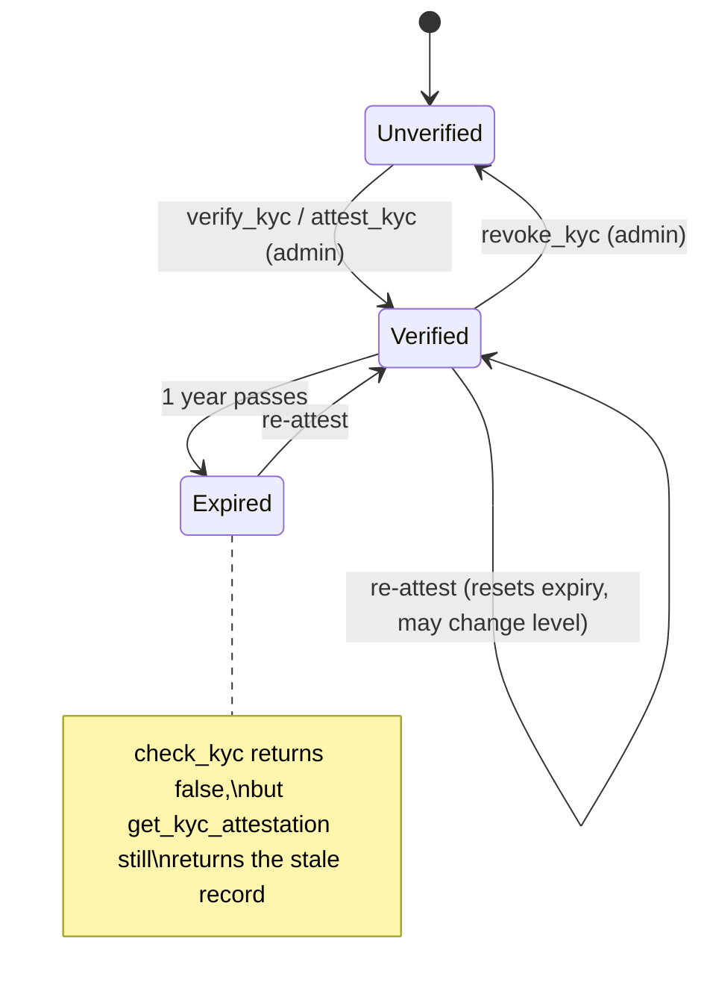

# Identity contract: what "verified" means

This page defines the attestations stored by the Soroban identity contract
([`backend/contracts/identity/src/lib.rs`](../backend/contracts/identity/src/lib.rs)).
It covers who can issue each one, when they expire, how they are revoked, and
how the app should read them. Read it before you derive a trust badge from
on-chain data (Issue #1567).

If you are new to Soroban, start with the
[Soroban smart contract docs](https://developers.stellar.org/docs/build/smart-contracts/overview).
An *attestation* here is a record in contract storage that says "the issuer
vouches that this address has property X". Anyone can read it. Only the
named issuer can write or remove it.

## Three independent attestations

Each attestation answers a different question, and none of them implies the
others.

| Attestation | Answers | Issued by | Levels | Expiry | Revoked by |
|---|---|---|---|---|---|
| **Social proof** | Does this address control social handle *H*? | The address itself, with an Ed25519 signature over `domain_hash` | Present or absent | None | The owner (`revoke_proof`) |
| **KYC attestation** | Did the platform check this person's identity documents? | Platform admin or a registered issuer (#1717) | `Basic` (0) < `Enhanced` (1) < `Institutional` (2) | 1 year after issue | Platform admin (`revoke_kyc`) |
| **Verification tier** | What trust tier has the platform assigned this creator? | Platform admin | `None`, `Verified`, `Trusted`, `Elite` | None | Platform admin (`revoke_tier`) |

"Platform admin" is the address stored by `initialize`. It can be rotated
with the two-step `propose_admin` / `accept_admin` flow (see
[contracts.md](./contracts.md#upgrading-a-contract-that-is-already-live)).

### Social proofs

- `submit_proof(owner, domain_hash, public_key, proof)`: `owner` signs the
  transaction, and the contract checks the Ed25519 signature `proof` over
  `domain_hash` under `public_key` (`env.crypto().ed25519_verify`). If the
  signature is bad, the call fails.
- The contract does **not** check that `public_key` belongs to the social
  account. The off-chain flow that produced `domain_hash` must establish that
  link. A social proof on its own means only that the owner holds a key that
  signed this hash.
- `has_proof(owner, domain_hash)` returns `true` while the proof exists.
  `proof_count(owner)` counts live proofs.

### KYC attestations

- `verify_kyc(admin, user, kyc_submission_id)` is what the app calls today
  (through [`server/services/identity-contract.ts`](../server/services/identity-contract.ts))
  after an admin approves a `KYCSubmission`. It always writes level `Basic`.
  The event carries the hashed submission ID so the on-chain record can be
  traced back to the off-chain review.
- `attest_kyc(admin, user, level)` writes an arbitrary level.
- Both calls **overwrite** any existing attestation and reset the one-year
  expiry. Re-issuing at a lower level downgrades the user.
- `check_kyc(user, required_level)` is the canonical read. It returns `true`
  only if an attestation exists, it has not expired (`now <= expires_at`),
  and its level is at least `required_level`.

### Verification tiers

- `set_tier(attester, owner, tier)`: the attester **must be the platform
  admin**. Before Issue #1567, any address could sign this for any owner,
  so tiers were self-issuable and must not be trusted. Ignore `tier_set`
  events that are earlier than this fix.
- `get_tier(owner)` returns the tier, or `None` if none was set or it was
  revoked.
- Tiers do not expire. Downgrade a tier with `set_tier`, or remove it with
  `revoke_tier`.

## Revocation

Revoking an attestation **deletes** it. After `revoke_kyc`, `check_kyc`
returns `false` at every level and `get_kyc_attestation` returns `None`, so a
revoked user reads exactly like one who was never verified. There is no
"revoked" flag to check and no way to tell the two cases apart on-chain. Use
the `(kyc, revoked)` event if you need the history. `revoke_tier` and
`revoke_proof` work the same way.

From the server, call `revokeKycOnChain(userAddress)` in
`server/services/identity-contract.ts`.

## KYC issuers, expiry and issuer-level revocation (Issue #1717)

Every KYC attestation (schema v2) carries `issuer_id`, `key_version`,
`issued_at`, `expires_at` and `schema_version`. Issuer `0`
(`ADMIN_ISSUER_ID`) is the platform admin, used by `attest_kyc` /
`verify_kyc`. Records written before #1717 are still read, mapped to
issuer `0`, key version `0`, `schema_version = 1`, until they expire.

| Entrypoint | Who signs | Effect |
|---|---|---|
| `register_issuer(admin, signer) -> u32` | admin | Adds an issuer (ids from 1) whose current key is `signer` |
| `rotate_issuer_key(caller, issuer_id, new_signer, invalidate_previous) -> u32` | admin or issuer's current key | Bumps `key_version`. With `invalidate_previous`, attestations signed by older keys stop validating at once |
| `revoke_issuer(admin, issuer_id)` | admin | Every attestation from that issuer stops validating, in O(1). Irreversible |
| `issuer_attest_kyc(signer, issuer_id, user, level, ttl_secs)` | issuer's current key | Writes an attestation valid for `1..=MAX_KYC_TTL_SECS` (one year) |
| `get_issuer(issuer_id) -> KycIssuer` | — | `{ id, signer, key_version, min_key_version, revoked, registered_at }` |

`check_kyc(user, level)` returns `true` only if the attestation exists, has
not expired, its issuer is not revoked, `key_version >= min_key_version`,
and its level is high enough.

**Compromised issuer key:** call `rotate_issuer_key(..., true)` (keeps the
issuer, kills the old key's attestations) or `revoke_issuer` (kills the
issuer). Neither touches individual records.

New errors (`KycError`, codes start at 101 so they never collide with
`IdentityError`): `NotInitialized` 101, `Unauthorized` 102,
`IssuerNotFound` 103, `IssuerRevoked` 104, `InvalidTtl` 105,
`AttestationNotFound` 106.

### Re-attestation job

`POST /api/admin/cron/kyc-reattest` (cron secret in `X-Cron-Secret`) calls
`reattestExpiringKyc` in
[`server/services/kyc-reattest.ts`](../server/services/kyc-reattest.ts).
For every approved, on-chain-verified `KYCSubmission` whose user has a
wallet, it reads `get_kyc_attestation` and calls `verify_kyc` again when the
attestation is missing, expires within `KYC_REATTEST_WINDOW_DAYS` (default
30), or is no longer valid per `check_kyc` (for example after an admin
issuer key rotation). KYC rows are deleted 90 days after upload for GDPR,
so only users still inside that window are re-attested automatically;
others must resubmit.

## How to read attestations for a badge

- **KYC badge:** use `check_kyc(user, level)`. Do **not** read
  `get_kyc_attestation` and display it without checking `expires_at`, because
  it still returns expired records.
- **Tier badge:** use `get_tier(owner)` and treat `None` as no badge.
- **Social badge:** use `has_proof(owner, domain_hash)`.
- Never combine these attestations: a high tier does not mean KYC passed, and
  passing KYC does not grant a tier.

## Events

These events can be read with Soroban RPC
[`getEvents`](https://developers.stellar.org/docs/data/apis/rpc/api-reference/methods/getEvents).

| Topics | Data | Emitted by |
|---|---|---|
| `(identity, proof_ok)` | `(owner, domain_hash)` | `submit_proof` |
| `(identity, revoked)` | `(owner, domain_hash)` | `revoke_proof` |
| `(kyc, attested)` | `(user, level)` | `attest_kyc` |
| `(kyc, verified)` | `(user, kyc_submission_id)` | `verify_kyc` |
| `(kyc, revoked)` | `(user, revoked_level)` | `revoke_kyc` |
| `(kyc, iss_reg)` | `(issuer_id, signer)` | `register_issuer` |
| `(kyc, iss_rot)` | `(issuer_id, key_version, invalidate_previous)` | `rotate_issuer_key` |
| `(kyc, iss_rev)` | `issuer_id` | `revoke_issuer` |
| `(kyc, iss_att)` | `(user, level, issuer_id, expires_at)` | `issuer_attest_kyc` |
| `(identity, tier_set)` | `(owner, tier)` | `set_tier` |
| `(identity, tier_rev)` | `(owner, revoked_tier)` | `revoke_tier` |

## Failure messages

Most entrypoints panic with a string message rather than a typed error:

| Message | Cause |
|---|---|
| `Not initialized` | `initialize` has not been called |
| `Only admin can attest KYC` / `verify KYC` / `revoke KYC` / `set tier` / `revoke tier` | Caller is not the stored admin |
| `KYC attestation not found` | `revoke_kyc` was called for a user with no attestation |
| `Tier not set` | `revoke_tier` was called for an owner with no tier |
| `Proof already verified` / `Proof not found` | Social proof already exists, or is missing |

## Deferred

- Admin-issued KYC expiry is fixed at one year; registered issuers choose a
  TTL up to one year.
- Tier attestations have no expiry.
